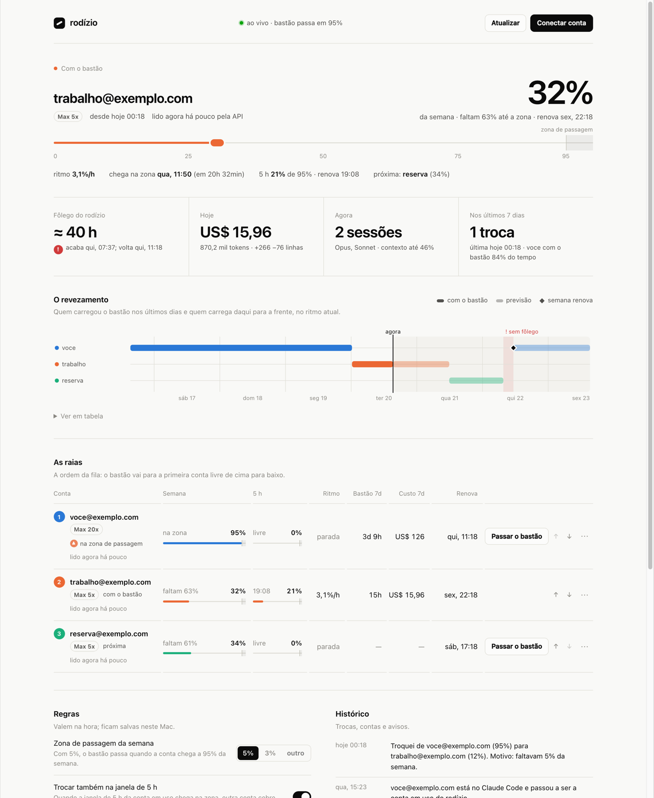

# rodízio

**Several Claude Code accounts, taking turns on their own, with nothing leaving your Mac.**

When the account in use gets close to the end of its weekly or 5-hour limit, the next account in line takes over within a
second and the session carries on. Logins stay in your Mac's Keychain; the dashboard only listens on `127.0.0.1`. No
cloud, no third-party server, no account to create, no telemetry, no npm dependencies.

[Português](README.md) · [Security (pt)](SECURITY.md) · MIT license



> The dashboard and messages are in Portuguese. Screenshots come from the demo mode, with sample accounts.

## What it does

- **Switches before the limit.** The last 5% (or 3%, or your choice) of the week and of the 5-hour window is the
  *exchange zone*; entering it hands the "baton" to the next account with room, in under a second.
- **Comes back to your preferred account** the moment its window resets.
- **Shows everything live:** weekly and 5-hour usage per account, spending pace, when each reaches the zone, how long the
  whole rotation lasts, a forecast of who carries the baton next, today's equivalent cost and tokens, open sessions and
  the switch history.
- **Looks after itself:** starts at login, restarts if it exits, a watchdog restarts it if it hangs, and
  `rodizio doctor` checks and repairs the installation.

## Privacy

- **Stays on your Mac:** logins (in the Keychain, in the items Claude Code itself creates), usage, history and settings
  (in `~/.rodizio`, readable only by your user).
- **Goes over the network:** only to Anthropic, with each account's own token: the official login (done by Claude Code
  itself), checking which account is in use and, if you want, reading each account's usage. Always identified as
  `rodizio`.
- **Never leaves:** your conversations, your code, your e-mails, your numbers. There is no rodízio server to send them to.
- **The dashboard:** `127.0.0.1` only, behind a key that only your browser has.

## Before you use it

- **Not an Anthropic product**, and not affiliated with Anthropic. It uses Claude Code for logins and the same endpoints
  Claude Code's `/usage` reads, which are not a documented API and may change.
- **Only your own accounts, used only by you.** Anthropic's
  [terms](https://www.anthropic.com/legal/consumer-terms) forbid sharing an account's login with anyone else.
- **There is a risk to the accounts.** Rotating accounts to keep working past one account's limit may be seen by
  Anthropic as working around a protection of the service, and accounts may be suspended. The choice and the risk are
  yours.
- No warranty: see the [license](LICENSE).

## Requirements

macOS, Node.js 20+, [Claude Code](https://code.claude.com/docs) logged into one of your accounts, two or
more Claude Pro or Max accounts of your own. Optional: Brave or Chrome, so other logins open in a private window.

## Install

Clone into a permanent folder (the service runs from it) and install:

```bash
git clone https://github.com/Jonhvmp/rodizio.git ~/rodizio
cd ~/rodizio
node bin/rodizio instalar
rodizio painel
```

Then, in the dashboard: add the account already in Claude Code (one click, no login), connect the others with
**Conectar conta** (the official login opens in a private window; if claude.ai asks for the 6-digit code sent by e-mail,
type it on the claude.ai page itself), and choose your margins under **Regras**.

```bash
rodizio status | rodizio painel | rodizio trocar <e-mail> | rodizio doctor [--reparar] | rodizio desinstalar [--apagar-tudo]
```

## Development

```bash
npm test        # the Keychain, the API and Claude Code are replaced by fakes
npm run demo    # the dashboard with sample accounts, touching no login
```
