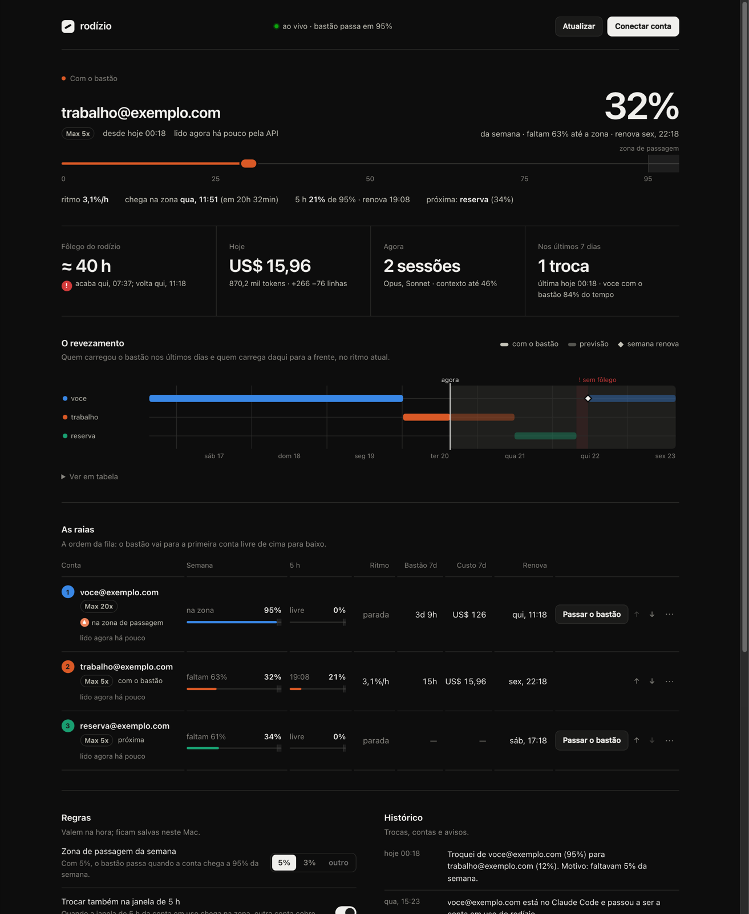
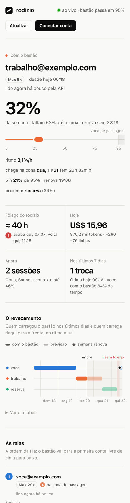

# rodízio

**Várias contas do Claude Code, revezando sozinhas, sem nada sair do seu Mac.**

Quando a conta em uso chega perto do fim da semana ou da janela de 5 horas, a próxima conta da fila assume na hora, e a
sessão continua. Os logins ficam no Keychain do seu Mac; o painel fica só em `127.0.0.1`. Sem nuvem, sem servidor de
ninguém, sem conta no rodízio, sem telemetria, sem dependências npm.

[English](README.en.md) · [Segurança](SECURITY.md) · Licença MIT


> Imagens do modo demonstração, com contas de exemplo.

## O que ele faz

- **Troca antes do limite.** Cada conta é uma raia; a que está em uso "carrega o bastão". Os últimos 5% (ou 3%, ou o que
  você escolher) da semana e da janela de 5 horas são a **zona de passagem**: ao entrar nela, o bastão vai para a
  próxima conta com folga, em menos de um segundo.
- **Volta para a preferida.** Quando a sua conta principal (a de plano maior, por padrão) renova a janela, o bastão volta
  para ela no mesmo segundo.
- **Mostra tudo ao vivo.** Uso da semana e das 5 h de cada conta, ritmo de consumo, quando cada uma chega na zona, o
  fôlego de todas juntas, a previsão de quem carrega o bastão nos próximos dias, custo equivalente e tokens do dia,
  sessões abertas e o histórico de trocas.
- **Cuida de si mesmo.** Sobe no login do Mac, volta se cair, um vigia religa se travar, e `rodizio doctor` confere e
  conserta a instalação.

## Privacidade

| | |
|---|---|
| **Fica no seu Mac** | Os logins (no Keychain, nas entradas que o próprio Claude Code cria), o uso, o histórico e as regras (em `~/.rodizio`, só para o seu usuário). |
| **Sai para a rede** | Só para a Anthropic, com o token de cada conta: o login oficial (feito pelo próprio Claude Code), a conferência de qual conta está em uso e, se você quiser, a leitura de uso de cada conta. Tudo se identificando como `rodizio`. |
| **Nunca sai** | Suas conversas, seu código, seus e-mails, seus números. Não existe servidor do rodízio para onde mandar. |
| **O painel** | Só em `127.0.0.1`, protegido por uma chave que só o seu navegador tem. Outro site aberto ou outro programa do Mac não consegue usá-lo. |

O código é pequeno e sem dependências justamente para você poder ler o que ele faz. Detalhes em [SECURITY.md](SECURITY.md).

## Antes de usar

- **Não é um produto da Anthropic** nem tem ligação com ela. Usa o próprio Claude Code para o login e os mesmos
  endereços que o `/usage` do Claude Code consulta, que não são uma API documentada e podem mudar.
- **Use só contas suas, só você.** Os [termos da Anthropic](https://www.anthropic.com/legal/consumer-terms) proíbem
  compartilhar o login de uma conta com outra pessoa.
- **Há risco para as contas.** Revezar contas para continuar trabalhando além do limite de uma delas pode ser visto pela
  Anthropic como contornar uma proteção do serviço, e a consequência pode ser a suspensão das contas. A decisão e o risco
  são seus.
- Sem garantia: veja a [licença](LICENSE).

## Requisitos

- macOS (usa o Keychain e o launchd)
- Node.js 20 ou mais novo
- [Claude Code](https://code.claude.com/docs) instalado e com login feito em uma das contas
- Duas ou mais contas Claude Pro ou Max, suas
- Opcional: Brave ou Chrome, para o login das outras contas abrir numa janela anônima

## Instalar

Clone numa pasta fixa (o serviço roda a partir dela, então não use uma pasta temporária) e instale:

```bash
git clone https://github.com/Jonhvmp/rodizio.git ~/rodizio
cd ~/rodizio
node bin/rodizio instalar
rodizio painel
```

O `instalar` mostra tudo o que faz:

- coloca o agente no launchd (`~/Library/LaunchAgents/local.rodizio.agente.plist`) e o vigia (`local.rodizio.vigia`);
- configura a linha de status do Claude Code em `~/.claude/settings.json`, guardando antes uma cópia do arquivo (se você
  já tiver outra linha de status, ela não é trocada; `--sem-linha-de-status` nem tenta);
- cria o comando `rodizio` em `~/.local/bin` e o app **Rodízio** em `~/Applications`;
- sorteia uma porta entre 41000 e 64000 e uma chave de acesso para o painel.

Não há nada a configurar em arquivo: o resto é no painel.

## Primeiros passos

1. **`rodizio painel`** (ou o app Rodízio, pelo Spotlight). O painel abre já com a chave de acesso.
2. **Adicione a conta que já está no Claude Code**: um clique, sem login nem código.
3. **Conecte as outras** em **Conectar conta**. O login oficial da Anthropic abre numa janela anônima. Se o claude.ai
   pedir o **código de 6 dígitos** enviado por e-mail, digite-o **na própria página do claude.ai**, nessa janela (não
   clique no link do e-mail: ele abre fora da janela anônima). Depois, autorize o Claude Code.
4. Em **Regras**, escolha as margens (5% ou 3% da semana e da janela de 5 h) e ponha as contas na ordem que quiser.

Pronto. A linha de status do Claude Code passa a mostrar a conta com o bastão e o uso da semana e das 5 h.

<p align="center"> </p>

## No dia a dia

```bash
rodizio status              # contas, uso e quem está com o bastão
rodizio trocar b@x.com      # passa o bastão agora
rodizio painel              # abre o painel (religa o agente antes, se precisar)
rodizio doctor              # confere agente, vigia, painel, linha de status, comando e app
rodizio doctor --reparar    # e conserta o que faltar
```

O painel fica sempre em `http://rodizio.localhost:<porta>`. Pelo menu do Brave ou do Chrome, **Instalar Rodízio** abre
o painel numa janela própria, como um app.

## Como ele decide

Duas janelas podem encerrar a vez de uma conta: a **semana** e a **janela de 5 horas**. Cada uma tem a sua zona de
passagem, os últimos N% dela (5% de fábrica; ajustável no painel, separadamente).

1. **Passa o bastão** quando a conta em uso entra na zona de qualquer janela, sai da fila, ou tem o login recusado.
2. **Para quem:** a primeira conta da fila com folga nas **duas** janelas.
3. **Espera em vez de trocar** quando a janela de 5 h da conta em uso renova em menos de 5 minutos (e ainda não travou).
4. **Volta para a preferida** quando ela tem folga de novo nas duas janelas (10 pontos antes de cada zona, 15 minutos
   depois da última troca). Uma escolha feita à mão fica até a conta chegar numa zona.
5. **Freios:** 90 s entre trocas automáticas; mais de 8 trocas automáticas numa hora seguram as próximas e avisam.
6. **Ninguém com folga:** fica na conta atual e avisa até alguma janela renovar.

## Como funciona

```
 Claude Code ──linha de status──▶ ~/.rodizio/amostras ──▶ agente (launchd) ──▶ troca no Keychain
      ▲                                                     │   ▲
      └──── usa o login da entrada principal do Keychain ◀───┘   └── painel ao vivo em 127.0.0.1
```

- **Cada conta entra pelo login oficial** (`claude auth login`), numa pasta própria (`~/.rodizio/contas/<id>`). O
  próprio Claude Code guarda esse login numa entrada do Keychain só dela. O rodízio nunca pede nem vê senha.
- **Trocar** é copiar o login da próxima conta para a entrada principal do Keychain (`Claude Code-credentials`) e o
  `oauthAccount` para o `~/.claude.json`. Os logins de servidores MCP ficam onde estão.
- **O token mais novo da conta em uso**, que as sessões renovam na entrada principal, é copiado para a entrada dela a
  cada mudança, para nada se perder.
- **O uso da conta em uso** vem da linha de status do Claude Code a cada resposta; o agente vigia essa pasta e decide em
  menos de um segundo (medido: ~350 ms). As contas paradas são lidas pela API a cada 15 minutos, e a conta em uso a cada
  45 s quando está perto de uma zona (para sessões sem linha de status, como `claude -p`).
- **O agente acorda no momento certo**: quando uma janela renova, quando termina uma espera, quando vence uma leitura.
- **O painel é ao vivo**: o agente empurra cada mudança para a página, que se reconecta sozinha se ele reiniciar.

## Casos de borda tratados

| Situação | O que acontece |
|---|---|
| Sem internet | A troca continua funcionando (é local, no Keychain). Leituras pela API esperam, com espera dobrando até 30 min por conta. |
| A Anthropic pede para esperar (429) | Respeita o `Retry-After` (até 1 h). |
| Token recusado (401) | Só marca "reconectar" depois de duas recusas, com minutos de intervalo, e se outra conta foi aceita **depois** da primeira recusa: numa queda que recusa todo mundo, ninguém é marcado. Um login recusado nunca volta para o Claude Code até o token mudar, e é conferido de novo a cada hora. |
| Sem resposta sobre de quem é o login do Claude Code | Não troca nada até a Anthropic confirmar; nunca adivinha. Pergunta de novo com espera crescente. |
| Sessão aberta renovando o token da conta anterior logo depois da troca | Guarda esse token na conta certa e refaz a troca; separa isso de um `/login` seu porque o `/login` também muda o `~/.claude.json`. |
| Sessão aberta que continua na conta anterior | Os números dela não são creditados à conta nova; depois de 3 minutos, o painel avisa para reabrir essa sessão. |
| Token da próxima conta perto de vencer | Renovado antes, para as sessões não disputarem a renovação. |
| Login novo que cai em cima da conta em uso | Devolve a conta em uso a partir da cópia atual dela e guarda o novo login na pasta certa. |
| Semana ou janela de 5 h que ainda não começou | Conta como 0%, começando no primeiro uso. |
| `state.json` ilegível | Guardado à parte; usa a cópia de segurança e remonta pelas pastas as contas que faltarem. Nunca recomeça do zero calado. |
| `~/.claude.json` sendo gravado pelo Claude Code | Usa a mesma trava `.lock`; se não conseguir, tenta de novo depois em vez de gravar por cima. |
| Agente travado (não só morto) | O vigia confere a cada 5 min e, depois de 3 checagens sem resposta, religa. |
| Desligamento no meio de uma troca | Espera a passada terminar; nunca salva uma troca pela metade. |
| Dois agentes ao mesmo tempo | O segundo sai. |
| Painel com versão diferente do agente | O painel avisa; configuração desconhecida é recusada em vez de ignorada. |

## Desinstalar

```bash
rodizio desinstalar                # tira agente, vigia, linha de status, comando e app
rodizio desinstalar --apagar-tudo  # também apaga os logins guardados e ~/.rodizio
```

O login que estiver no Claude Code na hora continua lá.

## Perguntas

**O painel abre em branco.** Quase sempre é o navegador que se atualizou com o app aberto: feche-o por completo (⌘Q) e
abra de novo. `rodizio doctor` mostra se o painel está respondendo.

**Uma sessão aberta continuou na conta antiga depois da troca.** O painel avisa. Feche essa sessão e abra de novo; as
novas já entram na conta com o bastão.

**Quanto uma 20x vale?** Para a previsão e o fôlego, o rodízio conta a 20x como quatro 5x, na semana e na janela de 5 h.

**Posso usar com a conta de um amigo?** Não: os termos da Anthropic proíbem compartilhar contas, e o rodízio foi feito
para as suas.

## Desenvolvimento

```bash
npm test             # os testes trocam o Keychain, a API e o Claude Code por versões falsas
npm run demo         # o painel com contas de exemplo, em ~/.rodizio-demo, sem tocar em nenhum login
```

O código está em `src/` (o agente), `web/index.html` (o painel, um arquivo só) e `test/`.
